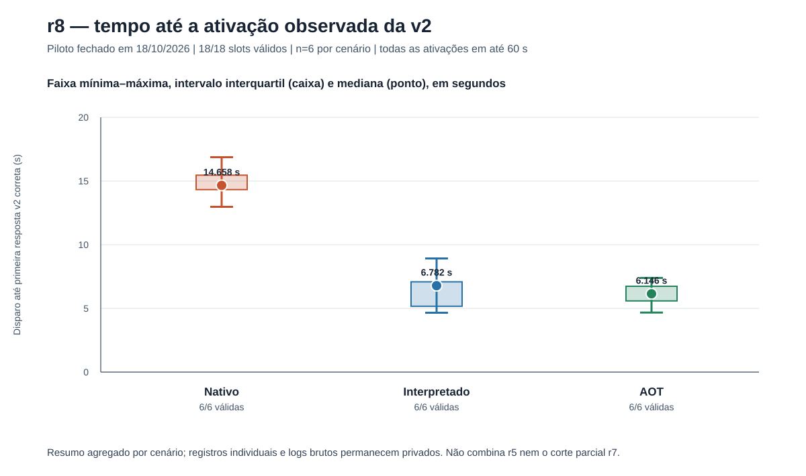
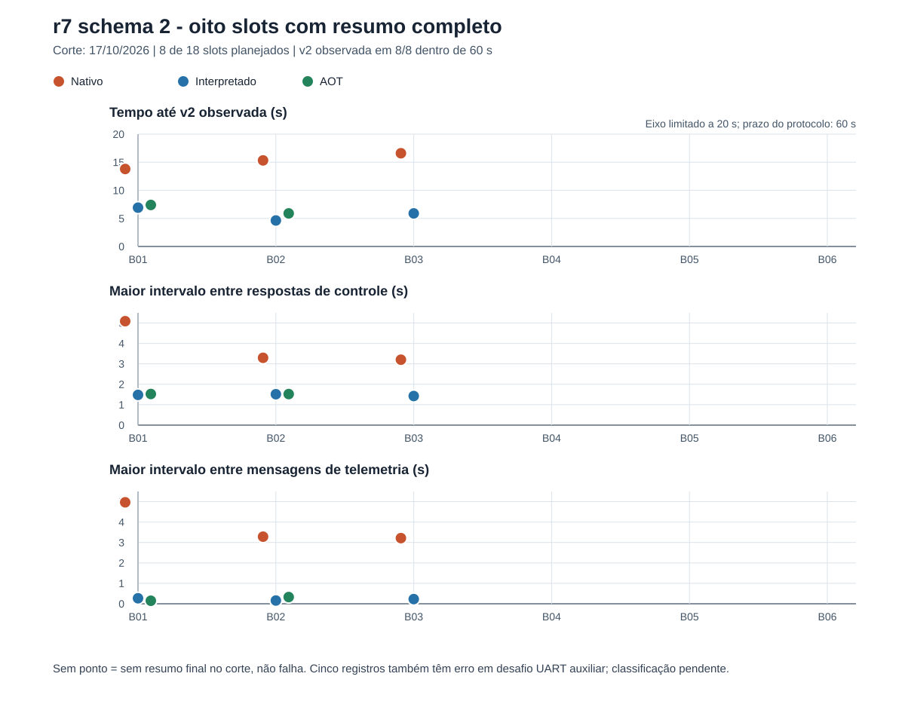

# Análise

## Piloto r8 da issue #20

A figura r8 apresenta, por cenário, o tempo entre o disparo e a primeira resposta v2 correta: linha fina de mínimo a máximo, caixa do intervalo interquartil e ponto da mediana. Cada grupo contém seis slots válidos. Todos os 18 tempos ficaram abaixo do limite protocolar de 60 s.



Os valores vêm do [CSV agregado por cenário](../data/r8-piloto-issue20-summary.csv); não há observações individuais neste pacote. Os resumos brutos permanecem privados. Para regenerar o SVG e o PNG:

```sh
python3 analysis/plot_r8_pilot.py \
  --csv data/r8-piloto-issue20-summary.csv \
  --svg analysis/figures/r8-piloto-18-slots.svg \
  --png analysis/figures/r8-piloto-18-slots.png
```

## Corte r7 schema 2

A figura abaixo foi gerada a partir do CSV sanitizado dos oito slots com resumo completo. Ela mostra separadamente o tempo até a ativação observada e os maiores intervalos entre respostas de controle e mensagens de telemetria.



| Cenário | n com resumo / 6 planejados | v2 observada até 60 s | Faixa do tempo (s) | Máx. intervalo de controle (s) | Máx. intervalo de telemetria (s) |
|---|---:|---:|---:|---:|---:|
| Nativo | 3/6 | 3/3 | 13,792-16,608 | 3,203-5,090 | 3,214-4,968 |
| Interpretado | 3/6 | 3/3 | 4,630-6,909 | 1,423-1,513 | 0,157-0,269 |
| AOT | 2/6 | 2/2 | 5,890-7,392 | 1,519-1,523 | 0,146-0,327 |

Os oito slots ainda aguardam adjudicação; cinco também têm erro no desafio UART auxiliar. A figura omite slots sem resumo final no corte, e eles não são tratados como falha. Os resultados são descritivos, com amostra pequena e rodada incompleta.

Para regenerar os arquivos SVG e PNG a partir do CSV:

```sh
python3 analysis/plot_r7_partial.py \
  --csv data/r7-piloto-schema2-8-slots.csv \
  --svg analysis/figures/r7-piloto-schema2-corte-8-slots.svg \
  --png analysis/figures/r7-piloto-schema2-corte-8-slots.png
```

O script usa apenas a biblioteca padrão do Python e `rsvg-convert` para renderizar o PNG.

## Plano de análise para o fechamento

1. Fluxo de slots: planejados, preparados, aceites, instrumentação válida/inválida/inconclusiva e restauração verificada por cenário.
2. Desfecho principal: slots com ativação observada no prazo sobre todos os slots planejados; mostrar numerador e denominador.
3. Desfecho após aceite: ativações no prazo entre atualizações aceitas com instrumentação válida; mostrar também falhas e censuras.
4. Tempos: mediana, mínimo, máximo e intervalo interquartil apenas quando houver observações suficientes; não calcular tempo para tentativas sem ativação observada.
5. Continuidade: lacunas de controle e telemetria, respostas tardias, perdas e dados não resolvidos, separados por cenário.

A r5, o corte parcial r7 e o piloto r8 devem aparecer separados, com perfil e protocolo indicados. O piloto r8 é concluído e adjudicado, mas não equivale à campanha definitiva de 30 blocos/90 slots nem a uma análise confirmatória.
