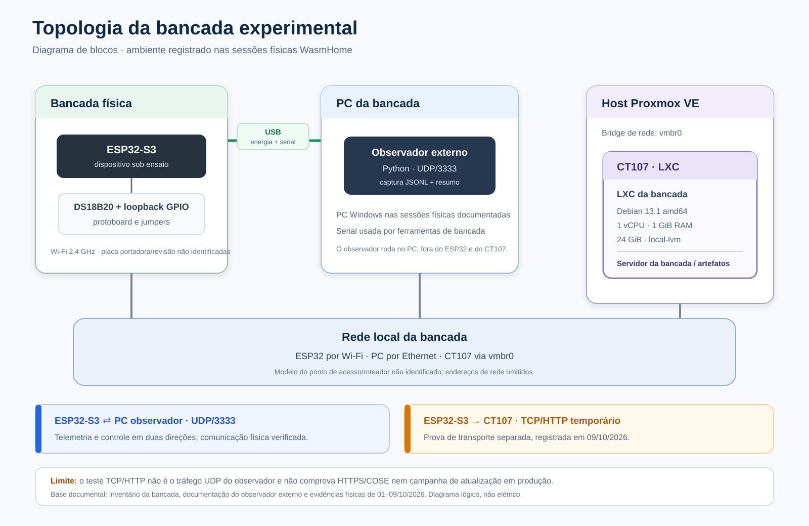
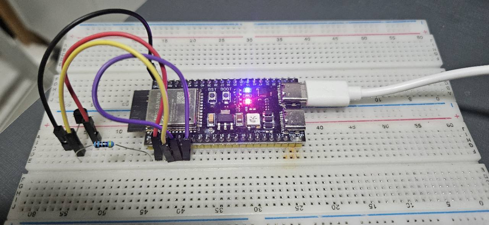
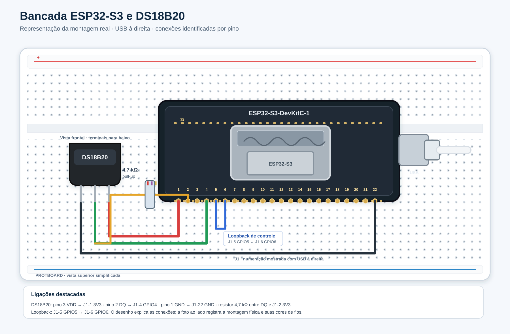
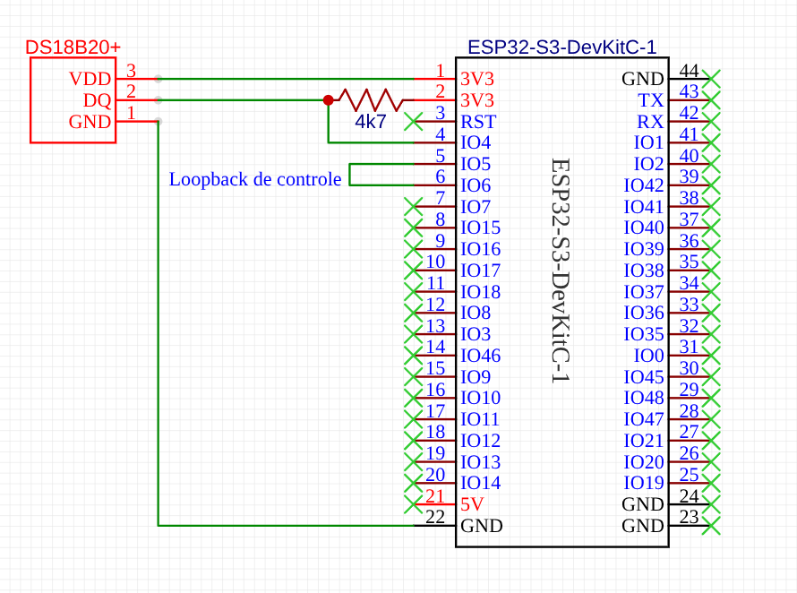

# Bancada experimental

Esta pasta reúne três tipos de evidência que devem ser lidos em conjunto: a topologia dos computadores e da rede, o esquema elétrico com as ligações identificadas e a fotografia da montagem física.

## Topologia do ambiente experimental

O diagrama separa a bancada ESP32-S3, o PC que executa o observador externo e o CT107 hospedado pelo Proxmox. A comunicação UDP/3333 entre o dispositivo e o observador foi verificada nas sessões físicas documentadas. O CT107 é o servidor LXC da bancada. O teste ESP32→CT107 registrado em 09/10/2026 usou um endpoint temporário TCP/HTTP; é uma evidência separada, não o fluxo UDP do observador nem uma prova de HTTPS/COSE. Endereços e identificadores de rede foram omitidos. Para repetir a coleta, consulte o [guia de reprodução](../reproduce/README.md).

## Foto da montagem real

A foto registra a placa ESP32-S3 montada na protoboard, com o cabo USB à direita. Os fios e o resistor aparecem como foram montados. Alguns pontos ficam parcialmente encobertos; por isso, a fotografia deve ser consultada junto com o esquema elétrico, que identifica cada ligação.

## Montagem ilustrada em estilo Fritzing

A ilustração acompanha a orientação da placa na foto e identifica os contatos do cabeçalho J1. Ela representa a montagem e ajuda a comparar a posição dos fios com a fotografia; o esquemático original acima é a referência para a leitura das conexões.

## Esquemático original e pinagem

Na ESP32-S3-DevKitC-1, os contatos J1-1 e J1-2 são 3V3; J1-4 é GPIO4, J1-5 é GPIO5, J1-6 é GPIO6 e J1-22 é GND. As ligações da bancada são:

- **DS18B20 VDD (pino 3)** → **J1-1 (3V3)**.
- **DS18B20 DQ (pino 2)** → **J1-4 (GPIO4)**.
- **Resistor de 4,7 kΩ** entre DQ e **J1-2 (3V3)**, como pull-up.
- **DS18B20 GND (pino 1)** → **J1-22 (GND)**.
- **Loopback de controle:** ligação direta entre **J1-5 (GPIO5)** e **J1-6 (GPIO6)**.

A numeração J1 e as funções dos pinos seguem o [guia oficial da ESP32-S3-DevKitC-1 v1.0](https://docs.espressif.com/projects/esp-dev-kits/en/latest/esp32s3/esp32-s3-devkitc-1/user_guide_v1.0.html). No DS18B20 mostrado de frente, com os terminais para baixo, a ordem é pino 1 GND, pino 2 DQ e pino 3 VDD. Confira a revisão da placa e a orientação do sensor antes de reproduzir a montagem.

## Limites da evidência

A foto documenta a montagem física; os diagramas explicam a pinagem e a topologia. Nenhuma figura, isoladamente, demonstra a validade de todos os slots da campanha. Os registros experimentais, os resumos sanitizados e o estado da adjudicação ficam nos diretórios de campanha e dados. Esta pasta faz parte do repositório público de evidências. O esquemático original fornecido pelo autor está publicado como PNG; registros brutos, firmware e imagem-base permanecem privados, por isso a reprodução externa da coleta segue limitada.
